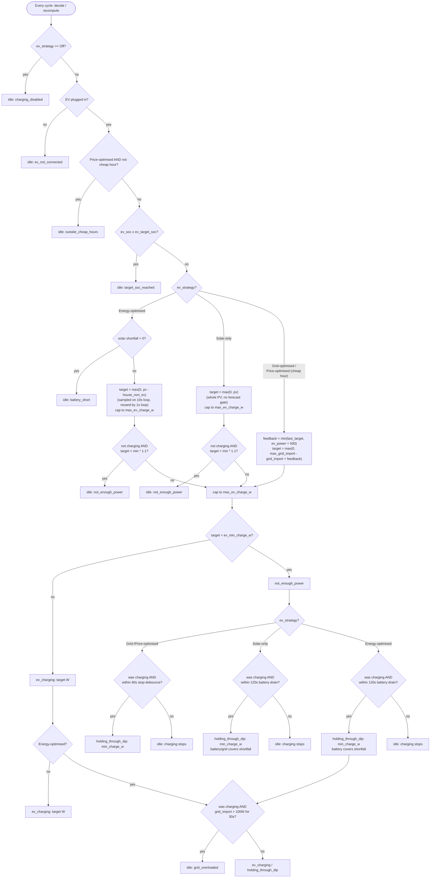
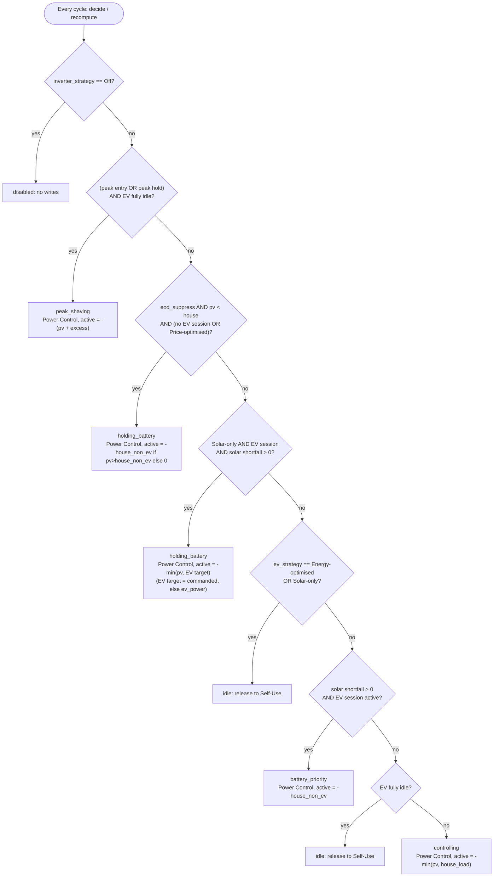

<p align="center"></p>

[](https://github.com/hacs/integration)
[](LICENSE)
[](https://github.com/thomasgodon/homeassistant-ems/actions/workflows/test.yml)

# EMS — Energy Management System

A brand-agnostic Home Assistant custom integration for **EV charging and battery management**. It decides how many watts your EV should charge at every second using solar surplus and available grid headroom, enforces a maximum grid import cap, prevents battery power from flowing to the EV, shaves grid import peaks with battery discharge, and steers the home battery toward a target SoC by end of day.

Works with any inverter that exposes a `select` entity for operating modes and a `number` entity for active power control — no inverter-specific code.

---

## Table of Contents

- [How it works](#how-it-works)
  - [Decision flow](#decision-flow)
  - [10-second strategy loop](#10-second-strategy-loop-emsstrategycoordinator)
  - [1-second fast loop](#1-second-fast-loop-emsfastloopcoordinator)
  - [Four decision paths](#four-decision-paths)
  - [EOD battery fullness decision](#eod-battery-fullness-decision)
- [Installation](#installation)
- [Configuration](#configuration-config-flow)
  - [Step 1 — Inverter](#step-1--inverter)
  - [Step 2 — EV Charger](#step-2--ev-charger)
  - [Step 3 — Battery Management](#step-3--battery-management)
  - [Step 4 — Grid](#step-4--grid)
- [Runtime inputs](#runtime-inputs)
- [Tunable thresholds](#tunable-thresholds)
- [EV charging mode](#ev-charging-mode)
- [Inverter control mode](#inverter-control-mode)
- [Outputs](#outputs-writes-to-your-hardware)
  - [Slow loop (10 s)](#slow-loop-10-s--controllerwrite_slow)
  - [Fast loop (1 s)](#fast-loop-1-s--controllerwrite_fast)
- [Exposed entities](#exposed-entities)
  - [Select entities](#select-entities)
  - [Number entities](#number-entities-numberems_)
  - [Sensor entities](#sensor-entities-sensorems_)
  - [Binary sensor entities](#binary-sensor-entities-binary_sensorems_)
- [Development](#development)

---

## How it works

EMS runs two execution loops. Every cycle both loops run an **EV algorithm** (`strategy.py`) and an **inverter control algorithm** (`inverter_control.py`), then write the results to your hardware.

### Decision flow

The two flowcharts below trace the exact branch order the code evaluates each cycle — first match wins. Chart A is the EV charge decision (`strategy.py::_make_decision` → `apply_stop_debounce`); Chart B is the inverter control ladder (`inverter_control.py::_compute`). The narrative "Four decision paths" and examples that follow elaborate on these branches.

**Chart A — EV charge decision**



Hard gates (`charging_disabled`, `ev_not_connected`, `outside_cheap_hours`, `target_soc_reached`, `battery_short`) are **never** debounced. In Grid-/Price-optimised modes only `not_enough_power` from a previously charging session is held through a brief 60 s dip. In **Solar-only** mode the same hold lasts up to **120 s** (battery, then grid, covers the held minimum) and there is **no** grid-overload cutoff — grid import is expected in this mode. In **Energy-optimised** mode two independent guards apply instead: a sub-minimum dip is held at `ev_min_charge_w` (the home battery covers the shortfall) for up to **120 s** before stopping, and — regardless of that timer — the session stops with reason `grid_overloaded` once grid import stays above **100 W** for **30 s** (the battery/inverter can no longer cover house + EV).

**Chart B — Inverter control ladder**



`active_power_w` is always clamped to ±`max_active_power_w`. Sign convention: negative = drain PV to AC; positive would charge the battery from AC (never emitted — the value is always ≤ 0, so the battery is never charged from grid and never drained for the EV).

### Four decision paths

Every ten seconds EMS asks two questions: **Will the home battery reach its target SoC by end of day?** and **Is the EV plugged in and being charged by EMS?** Combining the answers gives four paths.

#### Path 1 — Battery on track, EV idle

When the solar forecast is enough to fill the battery to target by evening and no EV session is active, EMS does nothing. The inverter runs in its native Self-Use mode — solar charges the battery, the battery powers the house at night — all without EMS involvement.

**Example:** Battery is at 60 %, target is 80 %, capacity is 10 kWh — a gap of 2 kWh. Remaining solar is forecast at 8 kWh and house load is forecast at 4 kWh, leaving 4 kWh of net solar for the battery. With 4 kWh of forecast and only 2 kWh needed, EMS stays out of the way.

#### Path 2 — Battery short

When the forecast shows solar won't fully charge the battery, EMS identifies the cheapest remaining hours of the day **that are also below today's median electricity price** and protects the battery during those hours. Instead of letting the battery drain to cover house load, EMS instructs the inverter to hold the battery flat — house load draws from cheap grid, solar that arrives goes into the battery. By the time the expensive evening hours arrive the battery is as full as it can be.

The number of protected hours scales with the shortfall: a large gap selects more cheap hours; a small gap selects fewer. If no remaining hour is below the day's median price — meaning the cheap window has already passed — EMS accepts the shortfall and lets the battery discharge normally rather than drawing expensive grid power.

Peak shaving overrides the hold if a grid spike occurs. Once peak shaving activates, it latches and only releases after grid import falls 500 W below the cap — this prevents the controller's own injection from immediately un-triggering peak shaving and causing on/off oscillation (the same class of instability prevented by the anti-windup cap in Path 4). The hold is also bypassed whenever PV alone covers the house load — Self-Use Mode handles routing without EMS involvement. In Grid-optimised mode, the hold is also bypassed during EV sessions — the EV integrator controls grid import and holding the battery simultaneously would interfere. In Price-optimised mode the hold still fires during an EV session: when PV exceeds the non-EV house load, the inverter serves the house from PV and the surplus charges the battery; when PV is below the non-EV house load, all PV charges the battery directly and the house draws from cheap grid. In both cases the EV draws from cheap grid and the battery never discharges.

**Example:** Battery needs 4 kWh but net solar forecast is only 2 kWh — shortfall is 2 kWh. Prices for the remaining day show 14:00 and 15:00 are the cheapest (and both are below today's median). EMS holds the battery flat during those two hours. House load draws from cheap grid; solar supplements the battery. If the time is already 19:00 and all remaining hours are above the median, EMS releases the battery to discharge through the evening peak.

#### Path 3 — EV in Energy-optimised mode

EMS first checks whether today's solar forecast, after covering the house load, still has leftover capacity beyond what the battery needs to reach its target.

- If the forecast says there is no leftover — the battery forecast is short — the EV stays idle. `sensor.ems_ev_status` shows *Solar reserved for home battery*.
- If the forecast says there is leftover, or if forecast data is unavailable, the EV charges at the live PV surplus above non-EV house load. The battery gets whatever PV is producing beyond what house and EV together need.

The surplus (`pv − house_non_ev`, where `house_non_ev = house_load − ev_power`) is computed **only on the 10 s strategy loop** and reused by the 1 s fast loop — it is *not* recomputed every second. `house_load` and `ev_power` are independent sensors (on this deployment, two asynchronous KNX telegrams) whose sampling can be skewed by seconds; because the EV's multi-kW draw appears in both, recomputing the subtraction every second let that skew inject up to the full EV power into the setpoint, and the fast loop chased it into a large, fast oscillation (the wallbox "flapping"). Sampling the subtraction once per slow cycle — when the telegrams have settled — severs that fast feedback while still tracking genuine PV changes on the next 10 s tick. Solar surplus moves slowly, so the coarser update is not a limitation; brief transients are absorbed by the battery and the guards below. (The fast loop still runs the grid-overload guard and the smoothing EMA every second.)

The inverter stays in its native Self-Use mode throughout — EMS never takes manual control over the inverter in this mode. Self-Use means the home battery naturally discharges to cover house + EV load whenever PV is insufficient, which is what enables the short battery-drain window described below.

To avoid rapid on-off cycling when surplus hovers near the minimum charge threshold, EMS applies **start hysteresis**: the EV begins only when surplus exceeds the minimum threshold by 10 %. Once charging, two independent guards — not an immediate stop — decide when to end the session:

- **Battery-drain window (120 s).** When PV surplus (`pv − house_non_ev`) drops below the minimum charge power, EMS does not stop straight away. It throttles the EV to exactly the minimum charge power and lets the home battery cover the shortfall for up to 2 minutes (status *Holding charge through brief dip*). Only a shortfall sustained past 120 s ends the session. If surplus recovers above the minimum first, the EV resumes following surplus and the timer resets.
- **Grid-overload cutoff (30 s).** Independently of the battery-drain window, if grid import stays above 100 W for 30 seconds — the house load has outgrown what the battery/inverter can supply, so the grid is being pulled — the session stops with reason `grid_overloaded` (status *Stopped — home load exceeds inverter capacity*). This fires faster than the 120 s window because a grid draw signals the battery can no longer help.

Whichever guard trips first ends the session.

**Example:** Battery capacity 10 kWh, current SoC 60 %, target 80 % — gap 2 kWh. Solar forecast remaining after house load: 4 kWh — plenty of leftover. At noon, PV generates 3 kW and the house (excluding the EV) needs 1 kW, so the EV charges at 2 kW. In the late afternoon, clouds reduce PV to 1 kW; surplus falls below the minimum, so EMS throttles the EV to 1.4 kW and the home battery supplies the ≈0.4 kW shortfall. If PV recovers within 2 minutes the EV ramps back up; if the shortfall persists past 2 minutes the EV stops. Were the house to switch on a large load and pull more than 100 W from the grid, the EV would instead stop after 30 seconds.

In a scenario where solar forecast leaves only 1 kWh of net solar for a 2 kWh battery gap, the shortfall is 1 kWh — the EV idles with *Solar reserved for home battery* regardless of how much PV is generating at that moment.

#### Path 3b — EV in Solar-only mode

The EV gets the **whole PV production**, not just the surplus: target = `pv` (capped by `max_ev_charge_w`). The rest of the house is not subtracted — it is fed by the home battery and/or the grid, whatever the electricity price. The EV charge decision ignores the battery forecast (no `battery_short` gate) and cheap hours.

What feeds the house depends on the end-of-day battery forecast (`solar_shortfall_kwh`):

- **Forecast OK (or unavailable)** — the inverter stays in native Self-Use, so the battery discharges to cover the house until it is empty or at its discharge limit; after that the house imports from the grid. Because the inverter cannot tell house watts from EV watts, the battery in effect also covers part of the EV draw.
- **Forecast short** (battery won't reach its target SoC by end of day) **during an EV session** — the battery is **not** drained. EMS switches the inverter to Power Control with `active_power = −min(pv, EV target)` (status `holding_battery`): the inverter outputs only what the EV takes, PV the EV can't absorb charges the battery, and the house runs entirely from the grid. During a hold at minimum with PV below it, the output is just `−pv`, so the EV's shortfall comes from the grid too. When the EV is idle, the inverter returns to Self-Use (the cheap-hour deficit hold of Path 2 still applies).

Start/stop: the EV starts only when PV exceeds the minimum charge power by 10 % (start hysteresis). When PV drops below the minimum, the session is held at the minimum for up to **120 s** (battery/grid covers the gap) and then stops. There is **no grid-overload cutoff** — only a sustained lack of PV stops the session. `pv` is a single sensor, so unlike Energy-optimised there is no telegram-skew issue and the 1 s loop recomputes the target directly.

**Example:** PV 3 kW, house (excluding EV) 2.5 kW. Energy-optimised would charge at 0.5 kW (below minimum → idle); Solar-only charges at 3 kW while the battery supplies the house's 2.5 kW. Once the battery is empty, the 2.5 kW comes from the grid and the EV keeps charging at 3 kW. If instead the forecast says the battery won't reach its target today, the battery is left alone from the start: the house's 2.5 kW comes from the grid immediately.

#### Path 4 — EV in Grid-optimised or Price-optimised mode

EMS integrates grid import toward the configured cap. The EV draws up to the cap minus current grid import, so total grid import stays at the cap. The battery is never drained for the EV.

An **anti-windup cap** prevents the integrator from racing ahead of the wallbox during its 5–15 s ramp-up: the commanded target can only project 500 W above the wallbox's measured draw. Without this cap, the integrator would overshoot to the wallbox maximum before it has ramped up, causing a grid spike that drives the target back below the minimum charge power and stops the session — which then immediately restarts, creating an on/off oscillation.

The integrator reads the **instantaneous** grid import — it is a pure integrator and only stays stable with near-zero feedback delay. (An earlier 60 s demand-averaging filter on this reading was removed: a low-pass in the integrator's feedback path adds phase lag that winds the target to the wallbox maximum before the grid reading catches up, then drives it past the minimum into idle, producing a slow stop/start oscillation.)

Short transients are instead handled by a **stop-debounce** that rides them out without touching the control loop. If a *charging* session's target momentarily falls below the minimum charge power (e.g. a rainwater pump draws ≈1 kW for 20 s), EMS holds the wallbox at the minimum charge power for up to 60 s rather than stopping — the status reads *Holding charge through brief dip*. Only a **sustained** shortfall lasting longer than 60 s actually ends the session. During the hold the grid may briefly exceed the cap; that is the accepted cost of not flapping the charger. Hard gates (EV unplugged, mode Off, target SoC reached, outside cheap hours, battery reserved) stop charging immediately and are never debounced.

The 60 s window is empirically grounded: across 9 days of live data, surplus dips while charging are bimodal — a transient cluster (median 10 s, ~68% under a minute) from clouds and pump cycles, and a tail of sustained shortfalls (p90 ≈ 340 s). 60 s sits in the valley between them, riding out transients without holding battery drain through a genuine shortfall. (In Energy-optimised mode the inverter is on Self-Use during the hold, so the home battery — not the grid — supplies the held minimum.)

> **Note (Price-optimised + cheap hour):** When both the battery forecast is short *and* the current hour qualifies as a cheap hold hour, Path 2 takes precedence over Path 4 — see Path 2 above.

**When the battery forecast is fine:** EMS sets the inverter to cover the full house load including the EV from PV. Whatever PV exceeds the combined load trickles into the battery. The battery charges naturally once the EV has reached its cap.

**When the battery forecast is short:** EMS keeps PV away from the EV. The inverter is instructed to cover only the non-EV house load from PV; the remainder of PV goes directly into the battery. The EV draws its power from grid within the cap. `sensor.ems_battery_status` shows *Prioritising battery — EV charging from grid*.

**Example (battery fine):** Grid cap 4.5 kW, battery gap 2 kWh, net solar forecast 6 kWh — plenty. PV producing 4 kW, non-EV house load 1 kW, EV drawing 3 kW, grid import 0 kW. EMS sets active power so PV covers house and EV; any PV above total load goes to the battery.

**Example (battery short):** Same setup but net solar forecast only 1 kWh for a 2 kWh battery gap — shortfall 1 kWh. EMS sets active power to cover only the 1 kW non-EV house load. The remaining 3 kW of PV goes into the battery. The EV's 3 kW draw comes entirely from grid, staying within the 4.5 kW cap.

### How the loops work

**10-second strategy loop** (`EmsStrategyCoordinator`):
1. Reads all configured HA entities into a frozen snapshot.
2. Runs the EV and inverter decision algorithms.
3. Skips writes for 60 seconds after startup to avoid flapping on unavailable sensors.
4. Writes the inverter verb, active power, and EV charge target.

Every configured input entity and every `select.ems_*` / `number.ems_*` entity triggers an immediate refresh on state change — the 10-second interval is a fallback only.

**1-second fast loop** (`EmsFastLoopCoordinator`):
Re-reads live power values (`pv_w`, `house_load_w`, `ev_power_w`, `grid_import_w`) and reruns both algorithms. Writes active power and EV charge target but never writes the inverter verb — verb enforcement is the slow loop's job. Battery, forecast, price, and SoC fields are carried from the last slow-loop result.

**Forecast coordinator** (`EmsForecastCoordinator`):
Polls every **5 minutes** and also refreshes immediately whenever one of the slow-changing source entities changes state: `battery_soc`, `battery_capacity_kwh`, `battery_target_soc`, `solar_forecast_json_entity`, `house_load_forecast_json_entity`. The 5-minute backstop poll is required because `solar_forecast_remaining_kwh` decays through the day as elapsed hours are excluded from the remaining estimate — even when the forecast JSON entity itself is unchanged (e.g. a Solcast payload published once in the morning). The eight forecast/battery sensors (`sensor.ems_battery_energy_to_target`, `sensor.ems_net_solar_remaining`, `sensor.ems_battery_solar_deficit`, `sensor.ems_expected_eod_battery`, `sensor.ems_solar_remaining`, `sensor.ems_solar_time_remaining`, `sensor.ems_solar_production_start`, `sensor.ems_solar_production_end`) are bound to this coordinator.

### EOD battery fullness decision

Each cycle EMS computes an effective solar forecast — remaining solar generation minus the house load that falls **within the solar production window**, floored at zero. Only house load between the first and last productive solar hour is subtracted; evening and night load after sunset cannot be served by solar anyway. When called before the solar window, the full window is summed. When called during the solar window, only the hours from now to the last productive hour are summed (current hour pro-rated by minutes remaining). EMS then compares the effective solar surplus to the remaining battery gap (capacity × distance from current SoC to target SoC). If effective solar covers the gap, the battery forecast is fine. If not, the shortfall drives the Path 2 and Path 4 battery-priority decisions.

For Path 2 (deficit hold), EMS filters remaining hours to those whose price is **strictly below today's median** and then selects the cheapest `N` of those, where `N` is large enough to cover the shortfall. This absolute price floor ensures EMS never holds the battery once the cheap window has passed — if all remaining hours are above the median, the hold is skipped and the battery discharges normally. This feature requires `battery_soc`, `battery_capacity_kwh`, `solar_forecast_json_entity`, and `prices_today` to all be configured; it is disabled silently if any of them is unavailable.

---

## Installation

**Manual:** Copy `custom_components/ems/` to `<config>/custom_components/ems/` and restart Home Assistant.

**Requirements:** Home Assistant 2024.11+, Python 3.12+.

After restart, add the integration via **Settings → Devices & Services → Add Integration → EMS**.

---

## Configuration (config flow)

The integration is configured in 4 steps — no YAML editing required.

The **Configure** button (Settings → Devices & Services → EMS → Configure) walks the same 4 steps with current values prefilled.

### Step 1 — Inverter

| Config key | Type | Required | Description |
|------------|------|----------|-------------|
| `pv_power` | `sensor` | **Yes** | Current PV generation (W) |
| `inverter_select` | select entity | No | HA select entity that controls inverter operating mode |
| `inverter_disabled_option` | text | No | Option string written to the inverter select when EV is idle (e.g. `"Self Use"`) |
| `inverter_power_control_option` | text | No | Option string written to the inverter select when EV is charging (e.g. `"Power Control"`) |
| `active_power_entity` | `number` / `input_number` | No | EMS writes computed active power (W) to this entity. Negative = inverter drains PV → AC; `0` = hold battery. EMS reads the entity's `min`/`max` attributes at startup and clamps all writes to that range so a hardware-limited inverter never receives an out-of-range value. |

### Step 2 — EV Charger

| Config key | Type | Required | Description |
|------------|------|----------|-------------|
| `ev_power` | `sensor` | **Yes** | Current EV charger power (W) |
| `ev_plug` | binary_sensor / input_boolean | No | Whether the EV is plugged in. When not configured EMS assumes always plugged. |
| `ev_soc` | `sensor` | No | EV battery state of charge (%) |
| `ev_target_soc` | `number` / `input_number` / `sensor` | No | SoC at which EV charging stops; reads entity at runtime; falls back to `80` % |
| `ev_charge_target_entity` | `number` / `input_number` | No | EMS writes the computed charge power (W) to this entity each cycle |
| `ev_max_charge_w` | `number` / `input_number` | No | Physical maximum output of the EV charger (W) |
| `price_signal_entity` | binary_sensor / input_boolean | No | Cheap-hour signal for `Price-optimised` mode. EMS charges only when `on`. |

### Step 3 — Battery Management

All fields optional. When not configured the corresponding battery features are disabled.

| Config key | Type | Description |
|------------|------|-------------|
| `battery_soc` | `sensor` | Current home battery state of charge (%) |
| `battery_capacity` | `sensor` / `number` / `input_number` | Total usable battery capacity. EMS reads `unit_of_measurement` and converts automatically — use **Wh** or **kWh**. |
| `solar_forecast_json_entity` | `sensor` | Sensor whose **state** is a JSON list of exactly 24 floats (Wh) indexed by calendar hour of today (index 0 = 00:00, index 23 = 23:00). EMS derives the remaining solar energy and the time until sunset from this data each cycle. **Replaces the old scalar `solar_forecast_remaining` field — existing installs must reconfigure.** |
| `house_load_forecast_json_entity` | `sensor` | Sensor whose **state** is a JSON list of exactly 24 floats (Wh) indexed by calendar hour of today (index 0 = 00:00, index 23 = 23:00). EMS sums only the hours that fall within the solar production window (first → last productive solar hour), so post-sunset house load never incorrectly reduces the solar surplus available for the battery. **Replaces the old scalar `house_load_forecast_remaining` field — existing installs must reconfigure.** When absent, house load is treated as 0 in the forecast comparison. |
| `prices_json_entity` | `sensor` | Sensor whose **state** is a JSON list of 24 floats (€/kWh or €ct/kWh) indexed by hour 0..23. Must be exactly 24 elements. Example: `[0.08, 0.07, 0.07, 0.08, 0.10, 0.14, 0.18, 0.21, 0.20, 0.17, 0.15, 0.14, 0.13, 0.14, 0.15, 0.17, 0.21, 0.25, 0.24, 0.22, 0.19, 0.16, 0.13, 0.10]` (hour 0 = midnight, hour 23 = 23:00). Only relative ordering matters so any consistent unit works. |

### Step 4 — Grid

| Config key | Entity domain | Required | Description |
|------------|--------------|----------|-------------|
| `grid_import_power` | `sensor` | **Yes** | Current grid import power (W); positive = importing |
| `house_load` | `sensor` | **Yes** | Total house load including EV (W) |
| `max_grid_import_w` | `number` / `input_number` | No | Hard ceiling on grid import (W); reads entity at runtime; falls back to `4500` W |

---

## Runtime inputs

Every 10 seconds `coordinator.py::_build_inputs()` populates the following `Inputs` dataclass fields:

| Field | Source |
|-------|--------|
| `now` | System clock (`dt_util.utcnow()`) |
| `grid_import_w` | `grid_import_power` entity |
| `pv_w` | `pv_power` entity |
| `house_load_w` | `house_load` entity |
| `ev_plugged` | `ev_plug` entity; defaults to `True` (plugged) when not configured |
| `ev_power_w` | `ev_power` entity |
| `ev_soc` | `ev_soc` entity (%) or `None` |
| `ev_strategy` | `select.ems_ev_charging_mode` |
| `inverter_strategy` | `select.ems_inverter_control_mode` |
| `is_cheap_hour` | `price_signal_entity` (Step 2); `True` when not configured or unavailable |
| `battery_soc` | `battery_soc` entity (%) or `None` |
| `battery_capacity_kwh` | `battery_capacity` entity, auto-converted to kWh (reads `unit_of_measurement`), or `None` |
| `battery_target_soc` | `number.ems_battery_target_soc`; defaults to `80` % |
| `solar_forecast_today` | `solar_forecast_json_entity` state parsed as 24-float tuple (Wh, indexed by calendar hour), or `None` |
| `solar_forecast_remaining_kwh` | derived from `solar_forecast_today`: pro-rated current hour + sum of future hours, converted to kWh; `None` when JSON unavailable |
| `house_load_forecast_today` | `house_load_forecast_json_entity` state parsed as 24-float tuple (Wh, indexed by calendar hour), or `None` |
| `prices_today` | `prices_json_entity` state parsed as 24-float tuple, or `None` |
| `thresholds` | `max_grid_import_w` entity; `ev_target_soc` entity; `ev_min_charge_w` from `number.ems_ev_min_charge_w`; `max_ev_charge_w` entity; `ev_charge_advised_cheap_hours` from `number.ems_ev_charge_advised_cheap_hours` |
| `mapping` | Inverter select + active power + EV charge target entities from config |

The 1-second fast loop re-reads: `pv_w`, `house_load_w`, `ev_power_w`, `grid_import_w`, `ev_plugged`, `ev_strategy`, `inverter_strategy`, `is_cheap_hour`; battery fields are carried from the last slow-loop result.

Every configured input entity and every `select.ems_*` / `number.ems_*` entity is also subscribed via `async_track_state_change_event`. A state change on any of them fires an immediate `async_request_refresh()` on the strategy loop, so threshold knobs, SoC sensors, price/forecast entities, and mode selects take effect on the next event-loop tick — not at the next 10-second boundary.

---

## Tunable thresholds

| Where | Key / Entity | Default | Unit | Description |
|-------|-------------|---------|------|-------------|
| Config flow Step 4 (entity selector) | `max_grid_import_w` | 4500 | W | Hard ceiling on grid import; used for EV headroom and peak shaving trigger |
| Config flow Step 2 (entity selector) | `ev_target_soc` | 80 | % | EV SoC at which charging stops |
| Config flow Step 2 (entity selector) | `ev_max_charge_w` | — | W | Physical maximum output of the EV charger; uncapped when not set |
| `number.ems_ev_min_charge_w` | — | 1400 | W | Minimum EV charge target; below this the EV stays idle |
| `number.ems_battery_target_soc` | — | 80 | % | Target home battery SoC to reach by end of day; used by EOD suppress logic and the `Energy-optimised` binary budget gate |
| `number.ems_ev_charge_advised_cheap_hours` | — | 4 | h | How many of the cheapest remaining hours of today count as "good time to charge" for the plug-in hint sensor |

---

## EV charging mode

| Entity | Options | Description |
|--------|---------|-------------|
| `select.ems_ev_charging_mode` | `Grid-optimised`, `Price-optimised`, `Energy-optimised`, `Solar-only`, `Off` | See below |
| `select.ems_ev_smoothing` | `Fast`, `Normal`, `Slow` | Controls the EMA alpha applied to the EV charge target in the 1-second fast loop. `Fast` (α=0.3, ~3 s settling), `Normal` (α=0.2, ~5 s), `Slow` (α=0.1, ~10 s). Default: `Fast`. |

### Mode details

| Mode | EV charges when | Battery |
|------|----------------|---------|
| `Grid-optimised` | Grid headroom available above the minimum charge threshold | Best-effort; EMS may also apply Battery priority (see Path 4) |
| `Price-optimised` | Same as Grid-optimised AND price signal is on | Best-effort; same Battery priority protection |
| `Energy-optimised` | Today's effective solar forecast covers house load plus battery gap AND live PV surplus exceeds minimum charge threshold (with 10 % hysteresis on start) | **Mostly protected** — EV charges from leftover solar; on a brief surplus dip the battery covers the minimum for up to 120 s, and the session stops if grid import exceeds 100 W for 30 s |
| `Solar-only` | PV production exceeds minimum charge threshold (with 10 % hysteresis on start); EV target = whole PV, battery forecast and prices ignored | **Forecast-dependent** — forecast OK: inverter on Self-Use, battery (then grid) feeds the house; forecast short during a session: battery not drained (Power Control, inverter outputs only the EV draw, excess PV charges the battery, house from grid). On a PV dip the minimum is held for up to 120 s, no grid-overload cutoff (see Path 3b) |
| `Off` | Never | Best-effort (EMS writes 0 W to charger) |

`Energy-optimised` uses a binary budget gate: the EV is either fully allowed or fully blocked, depending on whether today's effective solar forecast still has leftover capacity after the house load and battery gap are subtracted. When the forecast is fine the EV gets the full live PV surplus above non-EV house load. When it is not fine — or the battery is short — the EV stays idle regardless of how much PV is producing at that moment. When forecast data is unavailable, EMS assumes fine and lets the EV charge.

---

## Inverter control mode

| Entity | Options | Default | Description |
|--------|---------|---------|-------------|
| `select.ems_inverter_control_mode` | `Control Inverter`, `Off` | `Off` | `Control Inverter`: EMS applies the four-path decision every second. `Off`: EMS never writes to the inverter. EV charge target writes are unaffected. |

---

## Outputs (writes to your hardware)

`controller.py` is the only module that calls HA services.

### Slow loop (10 s) — `controller.write_slow()`

| Service | Entity | Condition | Value |
|---------|--------|-----------|-------|
| `select.select_option` | Inverter select entity (Step 1) | `inverter_control_mode = Control Inverter` AND `inverter_verb is not None` | `power_control_option` or `disabled_option` |
| `number.set_value` | Active power entity (Step 1) | `inverter_control_mode = Control Inverter` AND `active_power_w is not None` | See four decision paths |
| `number.set_value` | EV charge target entity (Step 2) | Always | Computed EV target watts (0 when idle) |

### Fast loop (1 s) — `controller.write_fast()`

| Service | Entity | Condition | Value |
|---------|--------|-----------|-------|
| `number.set_value` | Active power entity (Step 1) | `inverter_control_mode = Control Inverter` AND `active_power_w is not None` | Smoothed active power |
| `number.set_value` | EV charge target entity (Step 2) | Always | Smoothed EV target watts (0 when idle) |

Active power and EV target are cached — a service call is skipped if the value has not changed. Writes are skipped during the 60-second startup grace period.

---

## Exposed entities

### Select entities

| Entity | Options | Default | Description |
|--------|---------|---------|-------------|
| `select.ems_ev_charging_mode` | `Grid-optimised`, `Price-optimised`, `Energy-optimised`, `Solar-only`, `Off` | `Off` | EV charging strategy |
| `select.ems_ev_smoothing` | `Fast`, `Normal`, `Slow` | `Fast` | EMA smoothing speed for EV charge target in the 1 s loop |
| `select.ems_inverter_control_mode` | `Control Inverter`, `Off` | `Off` | Whether EMS controls the inverter select entity |

### Number entities (`number.ems_*`)

| Entity | Default | Unit | Description |
|--------|---------|------|-------------|
| `number.ems_ev_min_charge_w` | 1400 | W | Minimum EV charge power; below this the EV stays idle |
| `number.ems_battery_target_soc` | 80 | % | Target home battery SoC to reach by end of day |

### Binary sensor entities (`binary_sensor.ems_*`)

| Entity | On when | Off when | Description |
|--------|---------|----------|-------------|
| `binary_sensor.ems_ev_charge_advised` | EV is **not** plugged in AND (`price_signal_entity` is `on` OR current hour is among the cheapest `ems_ev_charge_advised_cheap_hours` of remaining hours today) | EV is plugged in, or it's not a cheap hour | Mode-agnostic advisory — fires regardless of `select.ems_ev_charging_mode`. Requires `price_signal_entity` or `prices_json_entity` to evaluate cheapness; if both are absent the sensor stays off. |

### Sensor entities (`sensor.ems_*`)

| Entity | Values | Description |
|--------|--------|-------------|
| `sensor.ems_ev_status` | prose string | Priority-ordered EV status with kW values and reason. Updated every second. |
| `sensor.ems_battery_status` | prose string | What the battery is focused on — includes expected EOD SoC and shortfall kWh when forecast data is available. Attributes: `focus`, `power_w`, `soc`, `target_soc`, `expected_eod_soc`, `shortfall_kwh`, `will_reach_target`. |
| `sensor.ems_pv_status` | prose string | Where solar PV is going right now and why. Attributes: `focus`, `pv_w`, `to_house_w`, `to_ev_w`, `to_battery_w`, `to_grid_w`. |
| `sensor.ems_grid_status` | prose string | Whether EMS is importing within cap, exporting, or peak-shaving. Attributes: `focus`, `import_w`, `max_import_w`, `headroom_w`. |
| `sensor.ems_inverter_mode` | `power_control`, `disabled`, or `None` | Current inverter verb from the last `InverterDecision`. |
| `sensor.ems_ev_current_w` | float (W) | Computed EV charge target EMS is writing to `ev_charge_target_entity`. `0` when idle. |
| `sensor.ems_inverter_active_power` | float (W) | Active power EMS is writing to `active_power_entity`. |
| `sensor.ems_battery_energy_to_target` | int (Wh) or unavailable | Wh still needed to bring the battery from current SoC to `number.ems_battery_target_soc`. Unavailable when `battery_soc` or `battery_capacity` is not configured. Always ≥ 0. |
| `sensor.ems_net_solar_remaining` | int (Wh) or unavailable | Today's remaining solar forecast minus the house load forecast within the solar production window, clamped to ≥ 0. Unavailable when `solar_forecast_json_entity` is not configured. |
| `sensor.ems_house_load_in_solar_window` | int (Wh) or unavailable | Forecasted house load that falls within the remaining solar production window (current hour pro-rated, now → solar end; `0` past sunset). Unavailable when `solar_forecast_json_entity` or `house_load_forecast_json_entity` is not configured. Icon: `mdi:home-lightning-bolt`. |
| `sensor.ems_battery_solar_deficit` | int (Wh) or unavailable | Signed energy balance: positive = solar forecast is short of filling the battery to target SoC, negative = solar surplus beyond the battery's charge gap. Unavailable when `battery_soc`, `battery_capacity`, or `solar_forecast_json_entity` is not configured. |
| `sensor.ems_expected_eod_battery` | float (%) or unavailable | Projected battery SoC at end of the solar day given remaining solar forecast minus windowed house load forecast, clamped to 100 %. Unavailable when `battery_soc`, `battery_capacity`, or `solar_forecast_json_entity` is not configured. Same value as the `expected_eod_soc` attribute on `sensor.ems_battery_status`. |
| `sensor.ems_solar_remaining` | int (Wh) | Solar energy remaining today as computed by EMS: current hour pro-rated by minutes left, plus sum of future hours. Returns `0` when `solar_forecast_json_entity` is unavailable or unparseable. Icon: `mdi:white-balance-sunny`. |
| `sensor.ems_solar_time_remaining` | int (s), `device_class: duration` | Seconds from now until the end of the last calendar hour that has non-zero solar forecast. HA renders this as HH:MM:SS. Returns `0` when all forecast values are zero, the last productive hour has already passed, or `solar_forecast_json_entity` is unavailable. Icon: `mdi:timer-sand`. |
| `sensor.ems_solar_production_start` | datetime or unavailable | Today's first calendar hour with non-zero solar forecast, as a HA timestamp. Keeps today's time even after the window has begun so the value always reflects the current day's forecast. Unavailable when the entire forecast is zero. Icon: `mdi:weather-sunset-up`. |
| `sensor.ems_solar_production_end` | datetime or unavailable | Datetime at which solar production is forecast to fall to zero today (start of the hour after the last productive hour). Keeps today's time even after sunset. Unavailable when the entire forecast is zero. Icon: `mdi:weather-sunset-down`. |

#### `sensor.ems_ev_status` messages (priority order)

| Message | Condition |
|---------|-----------|
| `Starting up…` | 60-second startup grace; writes suppressed |
| `EV charging disabled` | EV charging mode is `Off` |
| `EV not connected` | EV plug sensor reports not connected |
| `EV battery full (N% reached)` | EV SoC is at or above the configured target |
| `Waiting for cheap hours` | Mode is `Price-optimised` and current hour is not cheap |
| `Solar reserved for home battery` | Mode is `Energy-optimised` and solar forecast won't cover battery gap after house load |
| `Not enough surplus to charge` | Available headroom is below the minimum charge threshold (or below the 10 % hysteresis start band when starting from idle) |
| `Holding charge through brief dip` | Target fell below the minimum, but a previously charging session is held at the minimum charge power before stopping — up to 60 s in Grid-/Price-optimised (stop-debounce), or up to 120 s in Energy-optimised / Solar-only (battery-drain window, home battery covers the shortfall) |
| `Stopped — home load exceeds inverter capacity` | Energy-optimised only: grid import stayed above 100 W for 30 s, so the session stopped (`grid_overloaded`) — the battery/inverter can no longer cover house + EV |
| `Charging EV at N.N kW from solar surplus` | Actively charging; grid import ≤ 0 (exporting or balanced) |
| `Charging EV at N.N kW with grid headroom` | Actively charging; grid import > 0 (using allowed headroom) |

#### `sensor.ems_battery_status` messages (priority order)

Inverter-intent rows (1–5) override power-balance rows whenever EMS has an explicit control intent.

| Message | Priority | Condition |
|---------|----------|-----------|
| `Starting up…` | 1 | 60-second startup grace |
| `Battery SoC unavailable` | 2 | `battery_soc` is `None` |
| `Discharging to limit grid import · N%` | 3 | Inverter status is `peak_shaving` |
| `Holding for evening · N% (R of N cheap hours today) · forecast EOD N%, short X.X kWh` | 4 | Inverter status is `holding_battery`; house load drawn from cheap grid to preserve battery |
| `Prioritising battery — EV charging from grid · N% · forecast EOD N%, short X.X kWh` | 5 | Inverter status is `battery_priority`; PV reserved for battery, EV feeds from grid |
| `Battery full — N% reached` | 6 | `battery_soc ≥ battery_target_soc` and power balance within 200 W |
| `Charging from solar at N.N kW · N% · forecast EOD N%` | 7 | `pv_w + grid_import_w − house_load_w > +200` |
| `Powering house at N.N kW · N% · forecast EOD N%` | 8 | `pv_w + grid_import_w − house_load_w < −200` |
| `Idle · N% · forecast EOD N%` | 9 | Power balance within ±200 W |

SoC suffix (` · N%`) is omitted when `battery_soc` is unavailable. The `(R of N cheap hours today)` rank suffix on row 4 is omitted when price data is unavailable.

The ` · forecast EOD N%` suffix appears on rows 4–9 when `battery_soc`, `battery_capacity_kwh`, and `solar_forecast_json_entity` are all available. When the forecast is short of the target, `, short X.X kWh` is appended to the EOD suffix. Both are hidden when any required input is unavailable or when solar is forecast to fully cover the gap (shortfall ≤ 0).

#### `sensor.ems_pv_status` messages (priority order)

| Message | Condition |
|---------|-----------|
| `Starting up…` | 60-second startup grace |
| `No solar production` | PV generating less than 100 W |
| `Powering the house at N.N kW` | ≥ 70 % of PV going to house load |
| `Charging the EV at N.N kW` | ≥ 70 % of PV going to EV |
| `Charging the battery at N.N kW` | ≥ 70 % of PV going to battery |
| `Exporting N.N kW to grid` | ≥ 70 % of PV exported |
| `Producing N.N kW: house H kW, battery B kW, EV E kW, grid G kW` | No single destination ≥ 70 %; destinations < 0.1 kW omitted |

#### `sensor.ems_grid_status` messages (priority order)

| Message | Condition |
|---------|-----------|
| `Starting up…` | 60-second startup grace |
| `Exporting N.N kW to grid` | Grid flow is negative (exporting) |
| `Balanced (neither importing nor exporting)` | Grid flow within ±100 W |
| `At cap — battery discharging to limit import (N.N kW)` | Inverter status is `peak_shaving` |
| `At import cap of N.N kW` | Grid import within 200 W of `max_grid_import_w` |
| `Importing N.N kW (cap N.N kW, headroom N.N kW)` | Importing below cap |

---

## Migration note

**Removed in this release:** `sensor.ems_inverter_status` has been split into `sensor.ems_pv_status` and `sensor.ems_grid_status`. After upgrading, delete the orphaned entity from **Settings → Devices & Services → EMS → Entities**.

---

## Development

```powershell
pytest tests/                  # Run all tests (80% coverage gate)
pytest tests/test_strategy.py -o addopts="" `
  --cov=custom_components.ems.strategy `
  --cov-branch --cov-fail-under=100  # 100% coverage for pure module
python -m ruff check custom_components/ems tests  # Lint
```

CI runs lint + tests (`.github/workflows/test.yml`) and `hassfest` (`.github/workflows/validate.yml`) via GitHub Actions.
